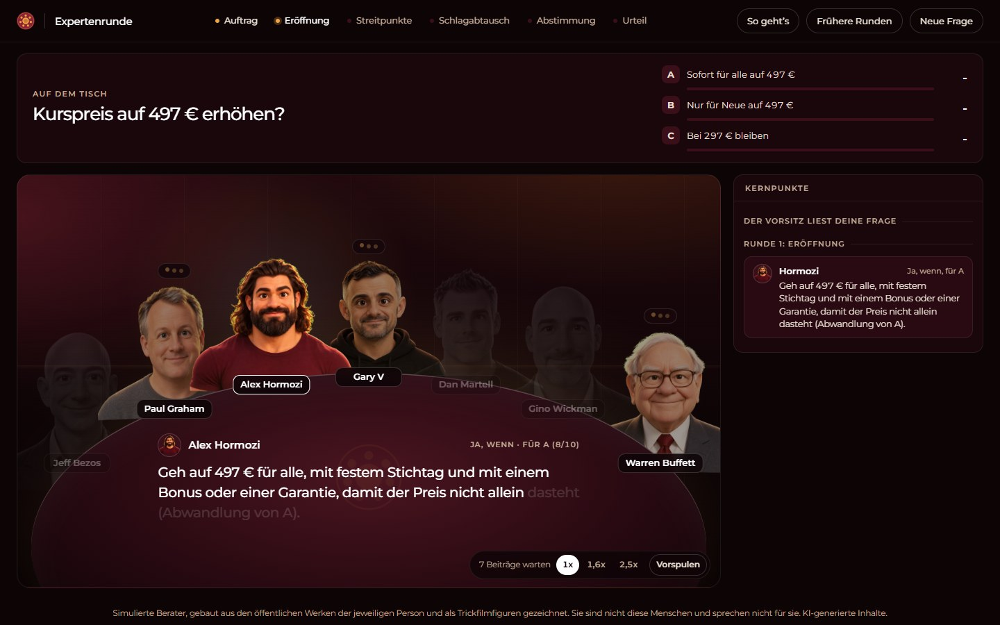

# Expertenrunde

*Deutsche Fassung des Open-Source-Projekts [Roast Room](https://github.com/nateherkai/roast-room) von Nate Herk (MIT-Lizenz, Copyright AI Automation Society). Die Marke und das Logo der AI Automation Society gehören nicht zur Lizenz und sind hier nicht enthalten. Diese Fassung ist eigenständig und wird von den ursprünglichen Machern weder betrieben noch empfohlen.*



Du bringst eine schwierige Geschäftsentscheidung mit, und eine Runde aus KI-Beratern streitet darüber. Am Ende bekommst du ein bewertetes Urteil und ein PDF mit einem Klick. Zwölf Berater sind dabei, jeder gebaut aus den öffentlichen Werken einer Person: Briefe, Essays, Vorträge, Videos. Für jede Frage schlägt der Vorsitz eine Besetzung vor, du bestätigst. Die Runde läuft in Claude Code, und eine kleine Webseite auf deinem Rechner zeigt die Berater an einem Tisch, wie sie es ausdiskutieren. Du willst jemand anderen am Tisch? `/newroaster` und ein Name, und Claude baut diesen Berater auf dieselbe Weise.

| Platz | Säule | Seine Leitfrage |
|---|---|---|
| Jeff Bezos | Strategie und Entscheidungen | Ist das die richtige Wette, und wie leicht lässt sie sich zurückdrehen? |
| Paul Graham | Produkt und Gründung | Wollen die Leute das wirklich, und wächst es? |
| Alex Hormozi | Angebote, Preise und Verkauf | Zahlen die Leute, wie viel, und wie schließen wir ab? |
| Gary Vaynerchuk | Marketing und Aufmerksamkeit | Woher kommt die Aufmerksamkeit, und ist sie gerade unterbewertet? |
| Dan Martell | Menschen, Einstellungen und deine Zeit | Wer macht das, und was kostet es deinen Kalender? |
| Gino Wickman | Abläufe und Wachstum | Läuft das im Betrieb, ohne dass du alles zusammenhalten musst? |
| Warren Buffett | Geld und Kapital | Was macht das mit Liquidität, Risiko und dem Wert auf lange Sicht? |

Diese sieben sind die **Standardbesetzung**. Fünf weitere sind auf Abruf, der Vorsitz holt sie dazu, wenn deine Frage in ihren Bereich fällt:

| Platz | Säule | Seine Leitfrage |
|---|---|---|
| Naval Ravikant | Hebel und Vermögen | Baut das Hebel und Eigentum auf, das dir gehört, oder vermietest du nur deine Zeit? |
| Codie Sanchez | Kleine Firmen kaufen und besitzen | Solltest du das selbst bauen oder etwas kaufen, das schon läuft? |
| Leila Hormozi | Führung und Teams aufbauen | Tragen dein Team und deine Führung das, und wer muss sich ändern? |
| Sara Blakely | Produkt und Marke aus dem Nichts | Lieben die Kundinnen es so sehr, dass sie es für dich verkaufen, ohne fremdes Geld? |
| Elon Musk | Grundprinzipien und Umsetzungstempo | Was ist hier die echte Grenze, und können wir Schritte streichen und schneller bauen? |

Die Wissensspeicher der Berater sind englisch, wie im Original. Alles, was du liest, kommt trotzdem auf Deutsch: Fragen, Beiträge am Tisch, Urteil und PDF. Wörtliche Zitate bleiben im englischen Original, damit sie sich gegen die Quelle prüfen lassen.

## Für wen

Für Selbständige und Gründerinnen, die vor einer schwierigen Geschäftsentscheidung stehen und sie einmal von allen Seiten durchdenken wollen: Preis, Angebot, Einstellung, Investition.

## So holst du dir die Expertenrunde

Die Expertenrunde ist ein ganzes kleines Projekt mit Webseite, nicht nur ein Skill. Du hast zwei Wege:

- **Aus diesem Paket:** Repo herunterladen (grüner Knopf **Code**, dann **Download ZIP**), entpacken und den Ordner `skills/expertenrunde` an einen Ort deiner Wahl kopieren, zum Beispiel nach `Dokumente\expertenrunde`. Das ist dein Projektordner.
- **Als eigenes Repo:** `git clone https://github.com/rundum-kreativ-mit-ki/expertenrunde.git`

Danach geht es weiter wie unten beschrieben. Installieren musst du außer Node.js nichts.

## Was du brauchst

- [Claude Code](https://claude.com/claude-code). Dein Claude-Abo deckt das ab, du brauchst keinen API-Schlüssel.
- [Node.js](https://nodejs.org) ab Version 20, für den Tisch. Sonst musst du nichts installieren.

## So startest du eine Runde

1. Tisch starten: im Projektordner `npm start`, dann http://localhost:3100 öffnen und offen lassen.
2. Claude Code im selben Ordner öffnen: `claude`
3. `/roast-room` tippen und dahinter deine Entscheidung.
4. Die Fragen des Vorsitzes beantworten, dann am Tisch zuschauen, wie die Runde streitet.
5. Steht das Urteil, auf **PDF herunterladen** klicken.

Im Chat bekommst du zusätzlich ein kurzes Urteil, der ganze Bericht liegt in `sessions/<datum>-<entscheidung>/verdict.md`.

## Was in deine Frage gehört

Die Runde ist nur so gut wie das, was du ihr gibst. Nenn:

- **Die Entscheidung** in einem Satz.
- **Deine Optionen.** Zwei oder drei. „So weitermachen wie bisher“ zählt auch.
- **Deine Zahlen.** Umsatz, Geld auf dem Konto, Teamgröße.
- **Deine Grenzen.** Frist, Stunden, Budget.
- **Woran du Erfolg misst**, und bis wann.
- **Wohin du tendierst**, und warum. Die Runde prüft deine Tendenz, statt ihr zuzustimmen.

Etwas vergessen? Der Vorsitz fragt nach, bevor die Runde startet. Beispiel:

```
/roast-room Ich verkaufe einen Online-Kurs für 297 € und mache damit rund 6.000 € im Monat.
Soll ich den Preis für alle auf 497 € erhöhen, nur für Neue erhöhen oder bei 297 € bleiben?
Etwa 3 % der Besucherinnen kaufen, auf dem Konto liegen 15.000 €. Erfolg wären 10.000 € im Monat bis März.
Ich tendiere zur Erhöhung für alle, weil der Kurs mehr wert ist.
```

Weitere Varianten:

- `/roast-room --quick ...` setzt vier Berater für zwei Runden. Für kleinere, umkehrbare Entscheidungen. Verbraucht viel weniger von deinem Claude-Kontingent.
- `/roast-room --seats hormozi,buffett ...` setzt nur die genannten Berater.
- `/roast-room ask hormozi ...` holt eine Antwort von einem einzigen Platz.
- `/roast-room --all ...` setzt alle Berater, die du hast (höchstens neun).
- `/roast-room board` zeigt, wer standardmäßig am Tisch sitzt, und ändert das.

Der Tisch ist freiwillig. Die Runde läuft in Claude Code genauso ohne ihn.

## Erst ein Beispiel ansehen

Starte den Tisch, öffne http://localhost:3100 und klick auf **Frühere Runden**. Eine fertige Beispielrunde liegt bei (Kurspreis-Frage mit erfundenen Zahlen, schnelle Runde mit Hormozi, Graham, Gary V und Buffett). So siehst du den Ablauf und kannst das PDF laden, bevor du deine eigene Runde startest.

## Wer am Tisch sitzt

Bei `/roast-room` liest der Vorsitz deine Frage und schlägt aus allen Beratern eine Besetzung vor, mit einer Zeile, warum jeder passt. Du wählst:

- **Vorgeschlagene Besetzung**: die fünf bis sieben Berater, die der Vorsitz für diese Frage ausgesucht hat.
- **Standardbesetzung**: deine üblichen sieben.
- **Alle**: alle zusammen, solange es neun oder weniger sind.
- **Andere**: Änderungen eintippen, etwa „Vorschlag, aber mit Naval und ohne Wickman“.

Jede Runde behält einen Platz, der dein Risiko bewacht, und einen, der wahrscheinlich widerspricht. So wird gestritten statt genickt.

Wie die Besetzung gewählt wird, steht in `.claude/skills/roast-room/roster.json`:

| Einstellung `"board"` | Was bei jedem `/roast-room` passiert |
|---|---|
| `"ask"` (Standard) | Der Vorsitz schlägt vor und fragt dich. |
| `"auto"` | Der Vorsitz wählt selbst und sagt dir, wen und warum. |
| `"default"` | Deine Standardbesetzung sitzt jedes Mal am Tisch. Keine Frage. |

Du musst die Datei nicht von Hand ändern. Tipp `/roast-room board` und sag, was du willst: „nimm Naval in meine Standardbesetzung“, „Gary V raus“, „frag mich nicht mehr, nimm einfach meine Standardbesetzung“.

## Eigenen Berater ergänzen

```
/newroaster Morgan Housel
```

Claude baut einen neuen Platz so, wie die ersten zwölf gebaut wurden:

1. **Zwei, drei Fragen**: welche Säule und Leitfrage der Berater übernimmt (mit Vorschlag), ob er in deine Standardbesetzung kommt, und wie gründlich gesucht wird.
2. **Öffentliche Werke finden**: Essays, Briefe, Vorträge, lange Interviews und Podcasts, in denen die Person selbst spricht.
3. **Holen** nach `build/<name>/`, einen lokalen Ordner, den Git nicht mitnimmt. Webseiten werden zu Text, YouTube-Videos zu Mitschriften.
4. **Denkweise herausziehen**: parallele Sub-Agenten lesen jede Quelle und ziehen Frameworks, Regeln, Positionen, Geschichten und Stimme heraus, mit wörtlichen Zitaten.
5. **Wissensspeicher schreiben** (`.claude/skills/roast-room/brains/<name>/`) und prüfen, dass jedes Zitat wörtlich in seiner Quelle steht.
6. **Agent schreiben** (`.claude/agents/council-<name>.md`) und in `roster.json` eintragen.
7. **Porträt zeichnen** im gleichen Trickfilmstil wie die anderen Berater.
8. **Den neuen Platz testen** mit einer Beispielfrage.

| Gründlichkeit | Quellen | Gut für |
|---|---|---|
| `--quick` | 12 bis 20 | Jemanden ausprobieren |
| Standard | 30 bis 50 | Einen Berater, den du nutzen wirst |
| `--deep` | 80 und mehr | Auf dem Niveau der ersten zwölf |

Ein normaler Aufbau sind etwa 8 bis 10 Sub-Agent-Läufe, das braucht einen spürbaren Teil deines Kontingents. Danach eine neue Claude-Code-Sitzung öffnen, damit der Berater als eigener Agent lädt.

**Sein Gesicht am Tisch:** `/newroaster` zeichnet das Porträt über die [Codex-CLI](https://github.com/openai/codex) von OpenAI, angemeldet mit einem ChatGPT-Abo. Dabei fallen keine zusätzlichen Kosten pro Bild an (es zählt gegen das Kontingent deines ChatGPT-Abos). Ein echtes Foto als Vorlage ist freiwillig. Aus dem Grundbild entstehen per Bildbearbeitung drei Sprechbilder (Mund offen, Mund „o“, Blinzeln), Python mit `opencv-python` setzt sie sauber zusammen. Ohne Codex funktioniert der Berater trotzdem und zeigt ein gezeichnetes Platzhaltergesicht. Das Porträt holst du später mit `/newroaster portrait <name>` nach.

YouTube-Mitschriften klappen am besten mit [yt-dlp](https://github.com/yt-dlp/yt-dlp), PDFs brauchen `pdftotext` ([Poppler](https://poppler.freedesktop.org)). Beides ist freiwillig.

## So funktioniert es

- **Die Runde läuft in Claude Code.** Jeder Platz ist ein Sub-Agent (`.claude/agents/council-*.md`, eingetragen in `roster.json`), der seinen eigenen Wissensspeicher liest (`.claude/skills/roast-room/brains/<name>/`): Frameworks, Grundsätze, Positionen, Geschichten und Stimme aus öffentlichen Quellen, jedes Zitat mit Quelle. Claude Code ist der Vorsitz: leitet die Runden, führt die Wertung, schreibt das Urteil (`.claude/skills/roast-room/SKILL.md`).
- **Jeder Platz bewertet jede Option**, gewichtet danach, wie sehr seine Säule bei deiner Entscheidung zählt. Meldet ein Platz Ruinrisiko, deckelt der Vorsitz das Urteil, und sind sich alle zu schnell einig, erzwingt er einen echten Streit.
- **Der Tisch schaut nur zu.** Der Vorsitz schreibt jeden Schritt nach `sessions/`, die Webseite spielt diese Dateien ab. Sie macht selbst keine KI-Aufrufe.
- **Jede Runde wird gespeichert** in `sessions/`. Unter „Frühere Runden“ spielst du sie ab und lädst ihr PDF.
- **Verbrauch:** Eine volle Runde sind drei Sub-Agent-Läufe pro Platz (21 bei sieben), das kostet einen echten Teil deines Kontingents. Für kleine Fragen `--quick`.
- **Nur auf deinem Rechner:** Der Server hört nur auf 127.0.0.1, die Schrift liegt lokal, die Seite lädt nichts von fremden Servern.

## Freiwillig: Runden direkt am Tisch starten

Wer Entscheidungen direkt in die Webseite tippen will, kopiert `.env.example` nach `.env`, trägt einen `ANTHROPIC_API_KEY` ein, setzt `COUNCIL_RUNNER=api` und startet neu. Das rechnet über dein Anthropic-API-Konto ab (etwa 25 Aufrufe pro voller Runde). Dieser Weg ist in der deutschen Fassung nicht getestet.

## Was drin ist

| Pfad | Was |
|---|---|
| `.claude/skills/roast-room/` | Der Runden-Skill: Ablauf, Rundenvorlagen, Wertung, Berichtsvorlage und ein Wissensspeicher pro Berater |
| `.claude/skills/roast-room/roster.json` | Alle Berater, deine Standardbesetzung und wie sie gewählt wird |
| `.claude/skills/newroaster/` | Der Skill `/newroaster` und seine Skripte: Quellen holen, Zitate prüfen, Platz eintragen, Porträt zeichnen |
| `.claude/agents/` | Ein Agent pro Berater (`council-<name>.md`) |
| `app/` | Der Tisch: ein Node-Server ohne Abhängigkeiten, die Webseite und der PDF-Bau |
| `sessions/` | Deine Runden (bleiben außerhalb von Git) |
| `build/` | Rohquellen von `/newroaster` und Porträt-Arbeitsdateien (bleiben außerhalb von Git) |

## Über die Berater

Das sind Simulationen, gebaut aus den öffentlichen Werken der jeweiligen Person, genau wie jeder Berater, den du ergänzt. Sie sind nicht diese Menschen, sprechen nicht für sie, und keiner von ihnen steht mit diesem Projekt in Verbindung oder empfiehlt es. Ein Platz zitiert eine Person nur wörtlich, wenn die Zeile mit Quelle in seinem Wissensspeicher steht. `python .claude/skills/roast-room/scripts/check_quotes.py sessions/<sitzung>` prüft jedes Zitat einer Runde gegen die Wissensspeicher. Die Datei `sources.md` jedes Wissensspeichers nennt, woraus er gebaut ist. Die Porträts sind KI-generierte Trickfilmfiguren (GPT Image über Codex), keine Fotos. Urteile und Beiträge sind KI-generiert.

## Lizenz und Herkunft

Der Code steht unter der MIT-Lizenz, siehe `LICENSE` (Copyright 2026 AI Automation Society). Diese deutsche Fassung beruht auf [github.com/nateherkai/roast-room](https://github.com/nateherkai/roast-room). Geändert wurden Sprache, Design, Porträts und der Porträt-Weg. Der PDF-Bau nutzt [jsPDF](https://github.com/parallax/jsPDF) (MIT) und [Montserrat](https://github.com/JulietaUla/Montserrat) (SIL Open Font License). Die Lizenzen liegen in `app/public/`.
